# WebCockpit

A MUD client for [MUME](https://mume.org) that runs entirely in your
browser. No installation and no server between you and the game: the
page connects straight to MUME. It is the browser sibling of
[MUME Cockpit][cockpit], with the same panes, menus and TUI look, and
aims for tt++-level features and latency.

<p align="center">
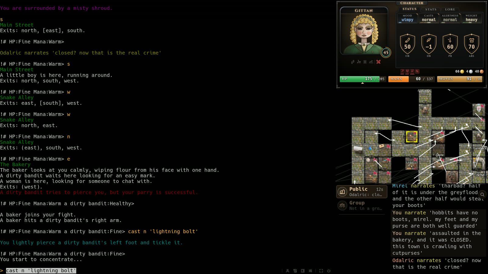
</p>

<p align="center">
<a href="https://youtu.be/6fVwlGGckUg"><b>▶ Watch the demo on YouTube</b></a>
&nbsp;·&nbsp;
<a href="https://mumecockpit.com/"><b>Play now at mumecockpit.com</b></a>
</p>

## At a glance

- **Nothing to install.** Open a link and play; the browser connects
  straight to MUME, with nothing in between.
- **Panes driven by GMCP:** a character card, spell timers, group,
  chats, the map and live XP statistics. Dock them on any side or let
  them float.
- **A map** that reads MMapper files and follows you as you move.
- **MUME's sky and weather in real time** over the whole client: sun
  and moon on the game clock, rain, fog, lightning and snow.
- **Scripting:** a tt++-style profile and sandboxed Lua 5.4 scripts.
  Imports profiles from TinTin++, Mudlet, JMC and Powwow.
- **Every session recorded:** replay it, cut and annotate it, and share
  it as a link or a standalone HTML file.
- **An optional account** keeps everything in step between devices,
  encrypted so that the server cannot read it.

## Run it

Open <https://mumecockpit.com/> in a desktop Chrome or Firefox. Nothing
to install. On a phone or tablet you can log in, chat and play lightly,
with a layout made for the thumb. Real play needs a computer.

<div align="center">
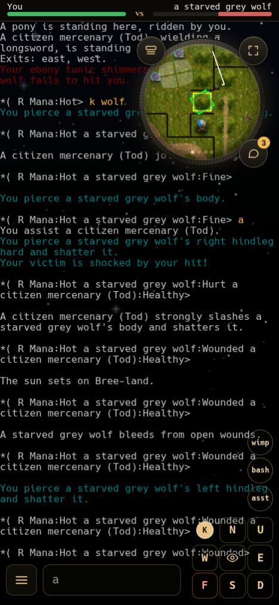
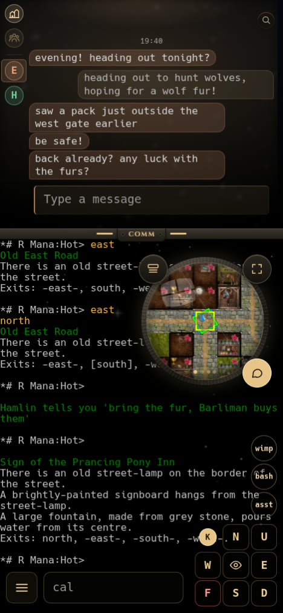
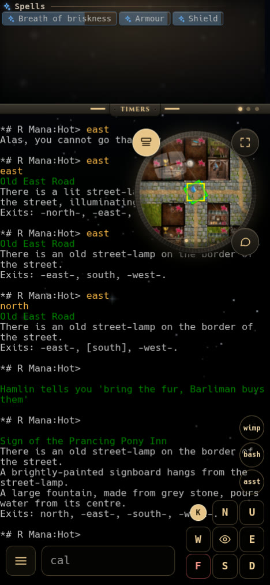
</div>

To run it locally you need [Node.js](https://nodejs.org) 24 or newer:

```
git clone https://github.com/Khazdul/webcockpit.git
cd webcockpit
npm ci
npm run dev
```

Then open <http://localhost:5173>. Hosting it yourself, serving it under
a subpath and reaching the dev server over Tailscale are described in
[`docs/hosting.md`](docs/hosting.md).

## What's in the box

**Start page.** MUME's sky by the game clock, even before you connect:
the sun and moon cross it, clouds drift, stars come out at night and the
season brings its weather. Everything on it can be reached from the
keyboard.

**Connection.** The browser talks to `wss://mume.org/ws-play/`
directly, with full GMCP and a keep-alive that shows your round-trip
time. Nobody in between sees your password.

**Panes.** Character, Spells, Group, Communication, Map and the live
Statistics of the run. Dock them on any side, in several columns or
rows, or let them float over the game. Each can be resized, reordered
and toggled, and has its own colour, border and frosted or clear
background.

**Character.** A card with your portrait and level, your vitals, mood
and position, and tabs for stats and lore.

**Comm and Statistics.** Comm is a conversation pane: the public
channels you pick, your group, and one chat per person, with search and
a reply line. Statistics follows the run live: each kill rated against
your recent ones, XP per hour and XP to the next level.

<div align="center">
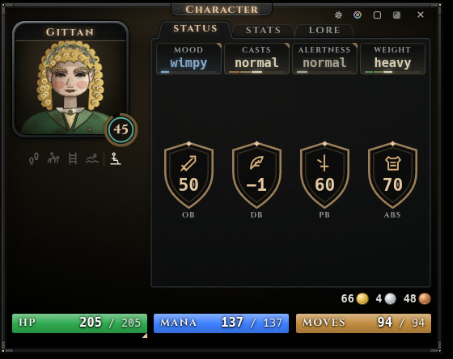
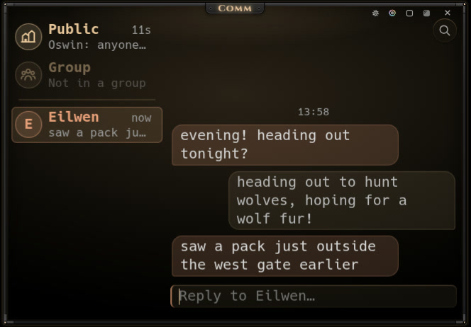
</div>

**Menu bar.** At the right end of the input line: the game clock, then
Profile, Scripts, Panes, Settings, Fullscreen and Exit. They open while
you keep playing, and each has a command (`#profile`, `#settings` and so
on) that a macro can bind.

**Appearance.** Fifteen bundled monospace fonts, font size, padding,
the ANSI palette and the cursor. Changes apply immediately.

<div align="center">
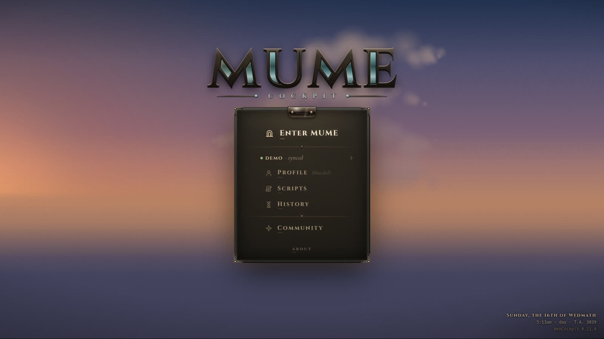
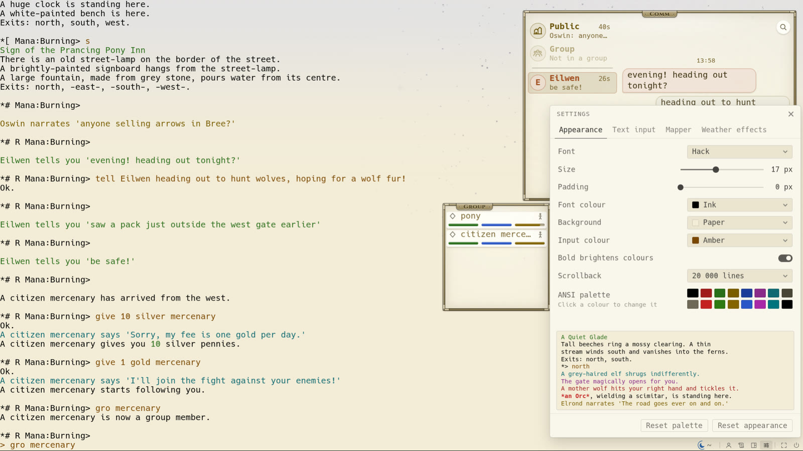
</div>

**Profiles.** Actions, aliases, highlights, macros, substitutes, gags,
variables and tickers in tt++ syntax. Edit them in a form or as text
with syntax highlighting; both edit the same profile. Import reads
TinTin++, JMC, Powwow and Mudlet profiles.

**Lua scripts.** Scripts in Lua 5.4 run beside the profile, in a
sandbox, with an API for triggers, aliases, keys, timers, GMCP, the map
and panes of their own. The editor completes names and marks errors,
and a manual is built in.

**Bundled scripts.** Ready to turn on: an almanac of MUME's seasons,
moon and events; a port key manager; map search like MMapper's Find
Rooms; shorter, colour-coded mob and movement lines; a mercenary
tracker; and a coin looter.

<div align="center">
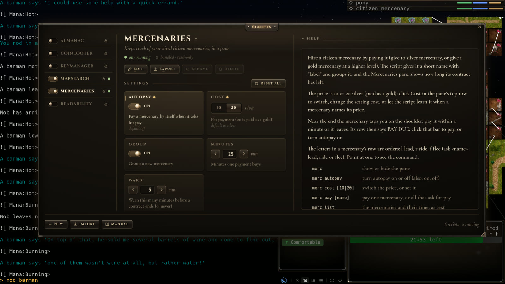
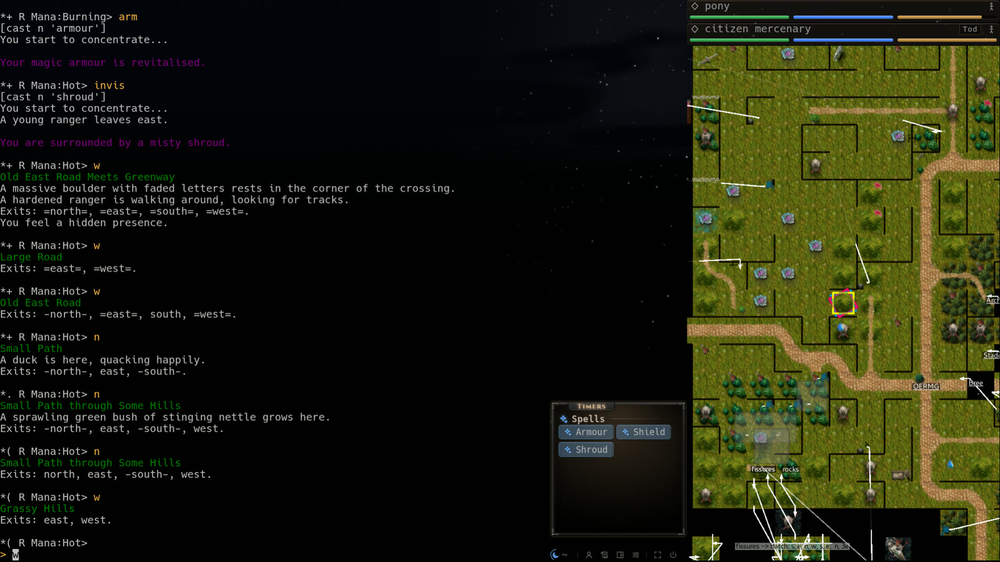
</div>

**Map.** A map pane that reads MMapper `.mm2` files, draws MMapper's
tiles and follows you as you move. A default map is bundled, and you
can import your own. Five tilesets to choose from.

**Weather effects.** Sky, rain, snow, fog and lightning over the whole
client, driven by the game's GMCP, and balloons that carry your kills,
level-ups, achievements and deaths across the sky. Settings picks what
to show. The drawing runs in a worker, so text and keys are never
slowed.

<div align="center">
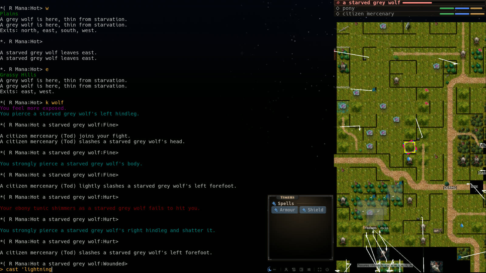
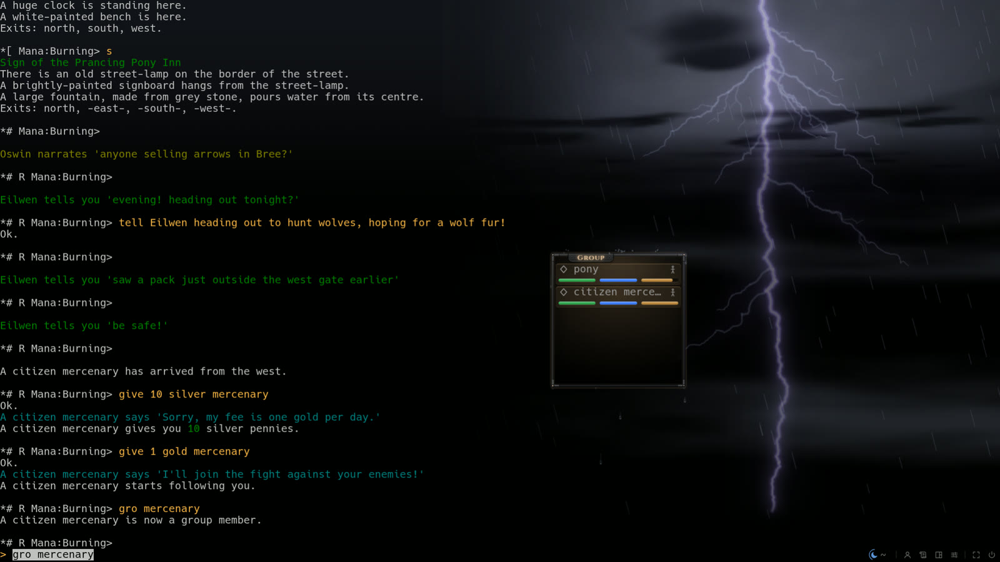
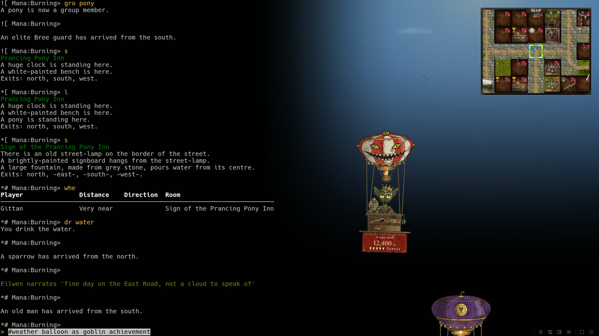
</div>

**Runs.** Every login starts a run, recorded in the browser. History
keeps them in three tabs: Sessions, with a log player that replays the
whole screen; Spotlights, your kills, deaths, level-ups and
achievements as cards that play; and the Diary, which tells your
characters' deeds as a book. Runs older than 14 days are pruned unless
you save them.

**Sharing.** Cut spans from a run, write comments to narrate it, and
export plain text or a self-contained HTML replay. With an account,
Share makes the run a link anyone can watch, or lists it in the Hall of
Fame.

**Accounts and the Community.** An account is optional. It keeps
profiles, scripts, settings and saved runs in step between devices,
encrypted in the browser with a key that only your password or recovery
code unlocks. The Community page lists the shared logs, with stars and
comments. What the server keeps is on the
[privacy page](https://mumecockpit.com/privacy).

<div align="center">
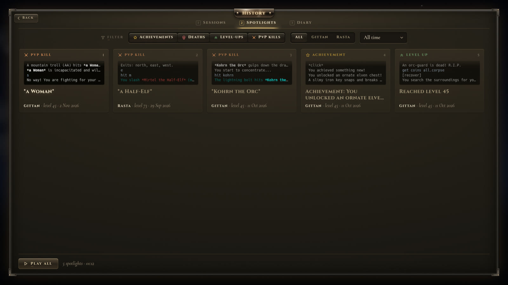
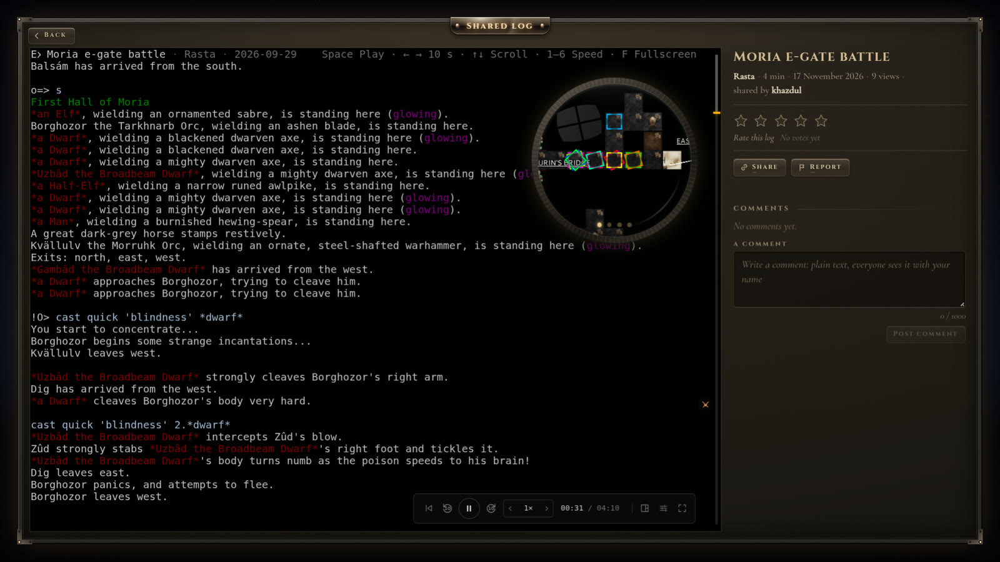
</div>

## Documentation

- [`intent.md`](intent.md): goals, non-goals and users.
- [`spec.md`](spec.md): architecture, features and the stage plan.
- [`docs/decisions/`](docs/decisions/): ADRs for design decisions.
- [`progress.md`](progress.md): stage status and development log.

## Status

In daily use and under active development, with frequent releases.
Bug reports and feature requests are welcome on
[GitHub Issues](https://github.com/Khazdul/webcockpit/issues).

## Related

- [MUME](https://mume.org): the game. Free, no subscription.
- [MUME Cockpit][cockpit]: the terminal client this one follows.
- [MMapper](https://github.com/MUME/MMapper): the mapper whose map
  files and tiles the Map pane uses.
- The tilesets: Shimrod's for MUME MMapper (and Desert, made from it),
  [Gefe & Rik](https://github.com/octavia-mc/gefe-rik-mmapper-tileset)
  by Octavia and [Gray's Map](https://github.com/Sunnyl75/Gray-s-Map-Tileset)
  by Sunnyl75.

## License

GPL-2.0-or-later, the same licence as MMapper, so code can move both
ways. See [`LICENSE`](LICENSE) and, for bundled fonts, libraries and
map assets, [`THIRD_PARTY_NOTICES.md`](THIRD_PARTY_NOTICES.md).

[cockpit]: https://github.com/Khazdul/mumecockpit
