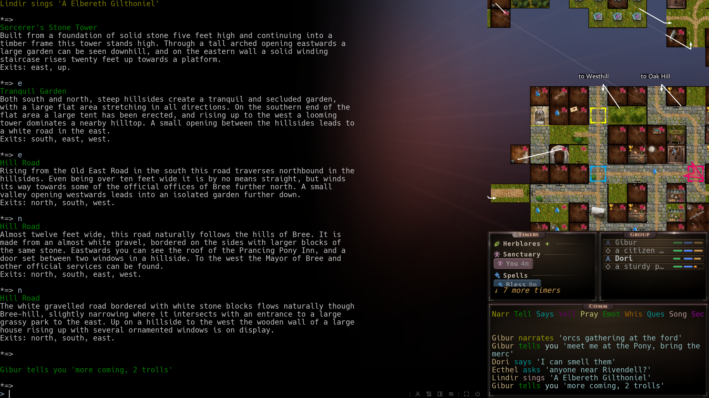
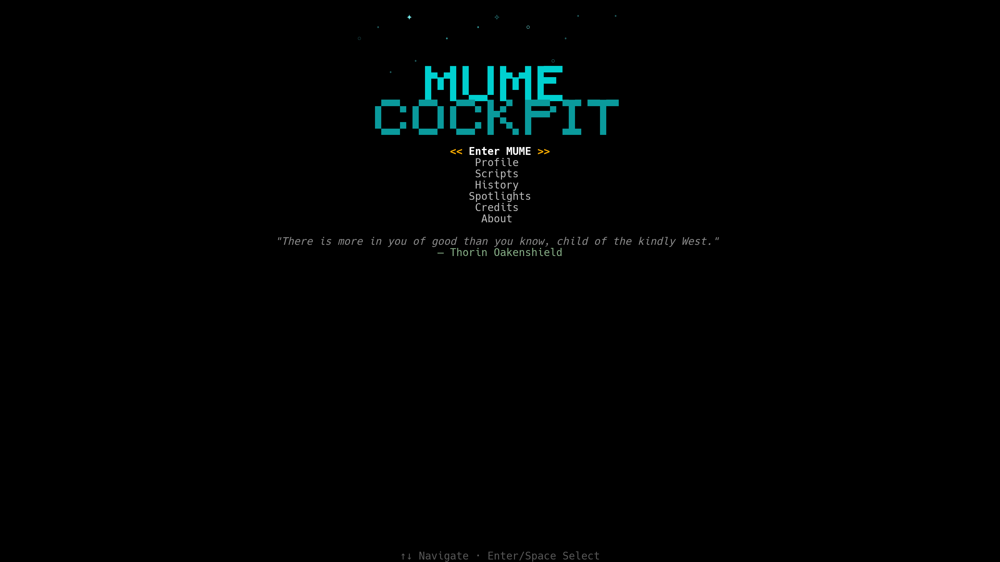
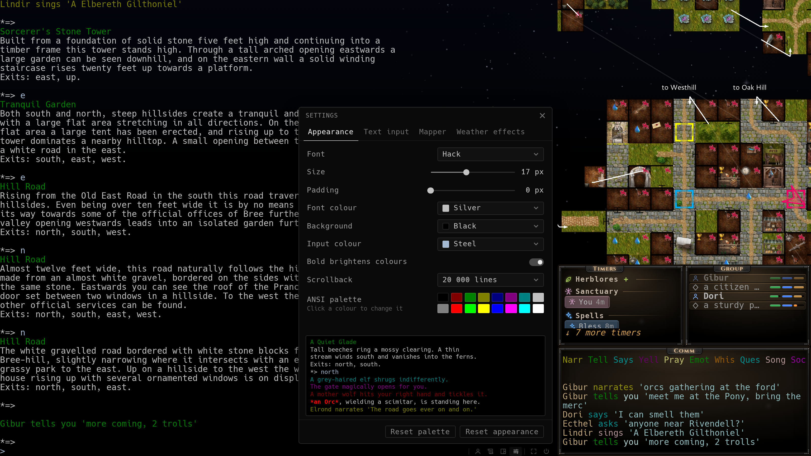
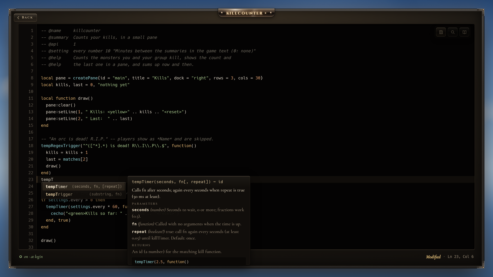
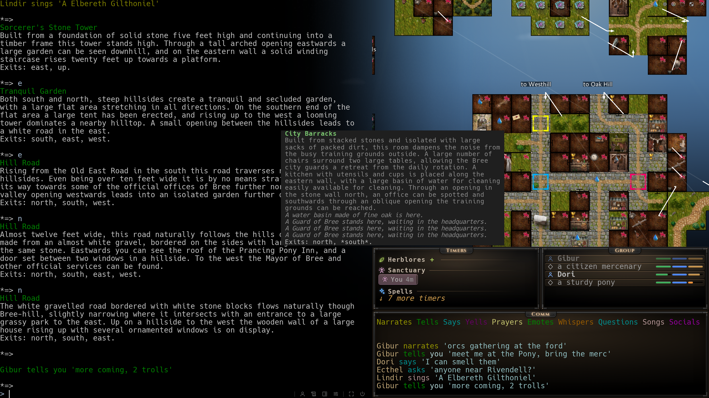
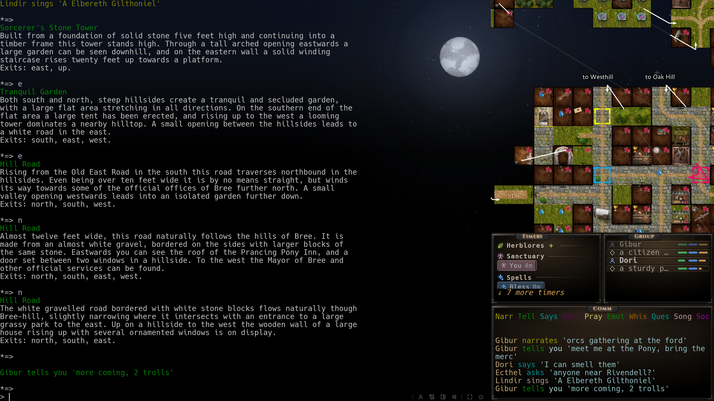
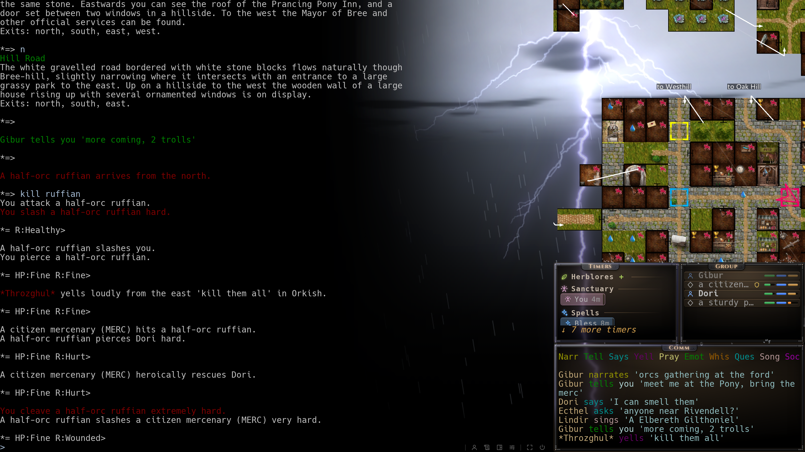
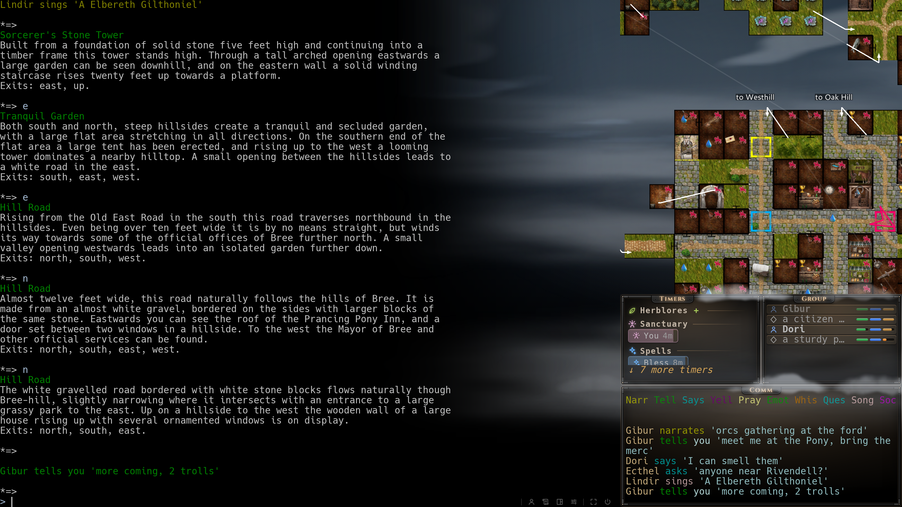
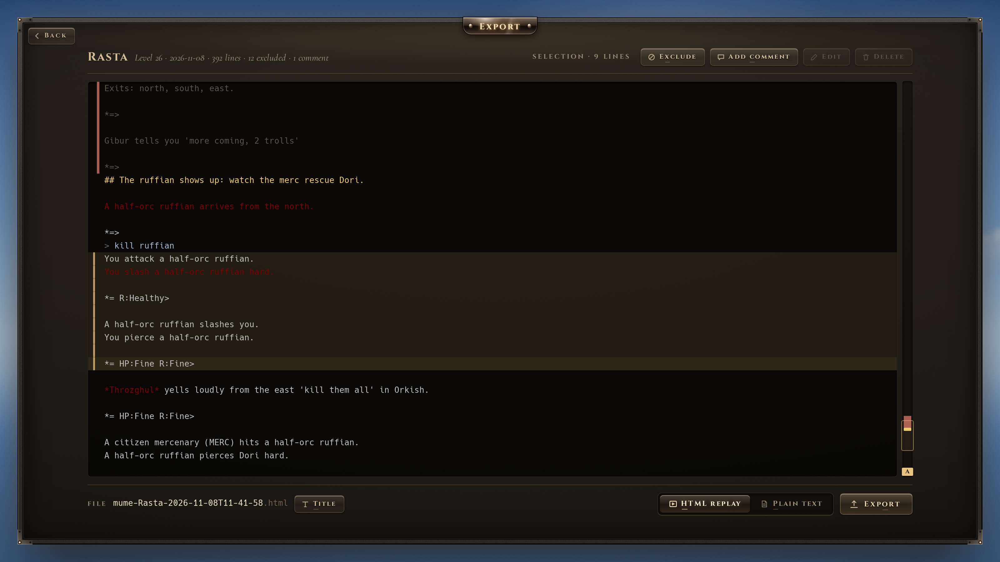
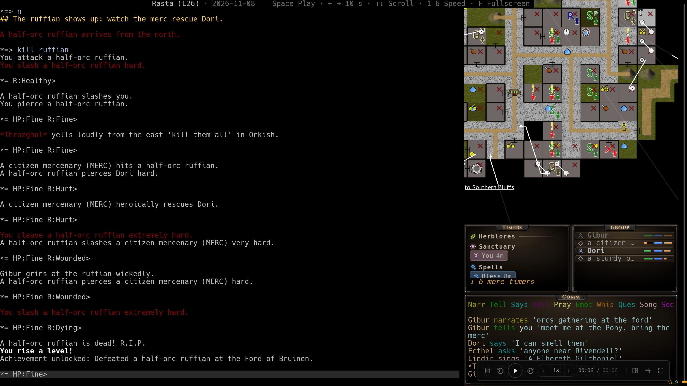

# WebCockpit

A MUD client for [MUME](https://mume.org) that runs entirely in your
browser. No installation and no server of its own: the page connects
straight to MUME, and everything you create (profiles, runs, settings,
maps) stays in your browser. It is the browser sibling of
[MUME Cockpit][cockpit], with the same panes, menus and TUI look, and
aims for tt++-level features and latency.

<p align="center">

</p>

## Run it

Open <https://mumecockpit.com/> in a desktop Chrome or
Firefox. Nothing to install. On a phone you can log in, chat and play
lightly: the game gets a layout made for the thumb, with an on-screen
keyboard of its own (Swedish or English) in place of the phone's. Real
play needs a computer.

WebCockpit is a static site. To run it locally you need
[Node.js](https://nodejs.org) 24 or newer:

```
git clone https://github.com/Khazdul/webcockpit.git
cd webcockpit
npm ci
npm run dev
```

Open <http://localhost:5173> in a desktop Chrome or Firefox.

To open the dev server from another device on your
[Tailscale](https://tailscale.com) network, proxy
`https://<machine>.<tailnet>.ts.net:5173` to `http://127.0.0.1:5173` with
`tailscale serve` and run `npm run dev:tailnet` (or set
`WEBCOCKPIT_DEV_HOSTS` to the proxy's host names;
[ADR 0096](docs/decisions/0096-dev-server-over-tailscale.md)).

To host it yourself, run `npm run build` and serve `dist/` from any
static file server that sends `.js` as JavaScript and `.woff2` as
`font/woff2`; no special headers are needed (the public site is plain
GitHub Pages, [ADR 0029](docs/decisions/0029-custom-domain-and-tailscale-retired.md)).
To serve it under a subpath, build with `WEBCOCKPIT_BASE=/path/ npm run build`
([ADR 0028](docs/decisions/0028-github-pages-deployment.md)).

## What's in the box

**Start page.** The page you land on shows MUME's sky by the game
clock, even before you connect: the sun and moon cross it, clouds drift,
stars and shooting stars come out at night, and the season brings its
weather (snow all winter, now and then rain in spring and autumn). Over
it sit the forged-iron MUME wordmark with its mithril inlay, the
menu, a Tolkien quote and, at the bottom right, the date and time in
Middle-earth. The keyboard drives it: ↑↓ and Enter, or the underlined
letter of each entry (E Enter MUME, P Profile, S Scripts, H History,
L Spotlights, C Credits, A About); Esc goes back. The mouse and a tap
work too. Each entry opens its page in a large box that grows out of
the menu, with Back at the top left; the letters marked in a page's
buttons are its shortcuts. The browser tab's icon is the same iron "M".

**Connection.** The browser talks to `wss://mume.org/ws-play/`
directly, with full GMCP and a keep-alive that shows
your round-trip time. Nobody in between sees your password.

**Panes.** Character, Timers, Group, Communication, UI messages,
Map and the live Statistics of the run. They can be docked left, right, at the bottom or at the top, in
several columns or rows per side with panes spanning the whole dock, or
float over the game, and resized, reordered and toggled, each with its
own background colour. A framed pane sits in a thin band of dark iron
with its name on a small hood, lit from within by its colour (pewter and
brass on a light background). Hover a pane for its buttons, left of the close
cross: step its colour, turn its border on or off, and switch its
background between frosted glass and clear (no fill, so what is behind
it shows sharp). In Firefox without GPU compositing, a large floating
pane hides the weather behind it once the client sees the screen lag, so
the text stays fast.

**Comm and Statistics.** Comm is a conversation pane: Public (the
channels you pick in its gear, NPCs' talk only if you turn it on), Group (everything your group's players
say) and one chat per person who talks to you, with search, a reply line
that sends a tell, and a column that folds away. Statistics follows the
run live: the last kill rated against the median of your recent kills
(from poor to superb), the average, the median, XP per hour and XP to the
next level, and every kill of the run. Type `#perf` for a small live
readout of frame rate and latency.

**Menu bar.** At the right end of the input line: the game clock (a sun
or moon in a ring that empties as the day or night runs out; hover it for
the time to the next change), then Profile, Scripts, Panes, Settings,
Fullscreen and Exit. Profile and
Scripts open movable windows and Settings a box of controls, all of them
live while you keep playing; `#profile`, `#scripts`, `#panes`,
`#settings`, `#fullscreen` and `#exit` do the same, so a macro can bind
them. On a phone the ESC menu (`☰`) holds them instead.

**Appearance.** Fifteen bundled monospace fonts, font size,
padding, the ANSI palette, cursor style and blink. Changes apply
immediately, from the menu bar's Settings in the game.

<div align="center">


</div>

**Profiles.** Actions, aliases, highlights, macros, substitutes, gags,
variables and tickers in tt++ syntax. The profile editor has three
views: Lite, a form for each kind; Editor, the whole profile as text
with syntax highlighting and find and replace; and Help, the manual.
Lite and Editor edit the same profile, and round-trips are lossless.
Macros bind any key the browser lets through. Profiles can be exported
and imported as `.tin` files, and import also reads TinTin++, JMC,
Powwow and Mudlet profiles: drop the files on the import page or choose
them, and a receipt counts the settings translated, kept as `#nop`,
skipped or in need of a look. The
start page's Profile list shows when each was last changed; the
highlighted profile has its own Select, Edit, Rename and Delete buttons
(S E R D), and New, Import and Export (N I X) sit below the list.

**Lua scripts.** Scripts in Lua 5.4 run beside the profile, in a
sandbox, with an API for triggers, aliases, keys, timers, GMCP, the map
and panes of their own, down to bars and buttons. The Scripts page
lists them beside the chosen script's panel: its settings as tiles that
take effect at once, and its help. The script editor completes names,
shows help as you type and marks errors, and a manual with contents,
find and highlighted examples is built in.

**Bundled scripts.** Ready to turn on in Scripts (on the start page or
the menu bar): an almanac of MUME's seasons, moon and events; a port key
manager; map search like MMapper's Find Rooms; shorter, colour-coded mob
and movement lines; a mercenary tracker; and a coin looter.

<div align="center">


</div>

**Map.** A map pane that reads MMapper `.mm2` files, draws MMapper's
tiles and follows you as you move. A default map is bundled, and you
can import your own. Settings → Mapper picks the tileset: MMapper's own,
Shimrod's seasonal tiles (which follow MUME's season), Desert, Gefe &
Rik and Gray's Map. Room notes show as in MMapper, and hovering a room
tells you about it.

**Weather effects.** Sky, rain, snow, fog and lightning over the whole
client, driven by the game's GMCP: the sun rises and sets on MUME's
clock and snow builds up on the panes. Settings → Weather effects turns
them off or picks what to show, and `#weather demo` plays them all. The
drawing runs in a worker, so text and keys are never slowed.

<div align="center">



</div>

**Runs.** Every login starts a run, recorded in the browser. The
start page offers History, a table of sessions with a card for the
chosen one (its Statistics, a log player that replays the whole screen,
rating, saving, export, deletion), and Spotlights, a wall of cards of
your kills, deaths, level-ups and achievements that play in a viewer
growing out of the card. Credits tells your characters' deeds as a
book, filtered as Spotlights is. Runs older than 14 days are pruned
unless you save them.

**Export editor.** Cut spans from a run, write comments at their place
in the log to narrate it, and export plain text or a self-contained
HTML replay that anyone can open without WebCockpit. It works on a
phone too.

<div align="center">


</div>

## Documentation

- [`intent.md`](intent.md): goals, non-goals and users.
- [`spec.md`](spec.md): architecture, features and the stage plan.
- [`docs/decisions/`](docs/decisions/): ADRs for design decisions.
- [`progress.md`](progress.md): stage status and development log.

## Status

In daily use and under active development, with frequent releases.
Bug reports and feature requests are welcome on
[GitHub Issues](https://github.com/Khazdul/webcockpit/issues).

## Related

- [MUME](https://mume.org): the game. Free, no subscription.
- [MUME Cockpit][cockpit]: the terminal client this one follows.
- [MMapper](https://github.com/MUME/MMapper): the mapper whose map
  files and tiles the Map pane uses.
- The tilesets: Shimrod's for MUME MMapper (and Desert, made from it),
  [Gefe & Rik](https://github.com/octavia-mc/gefe-rik-mmapper-tileset)
  by Octavia and [Gray's Map](https://github.com/Sunnyl75/Gray-s-Map-Tileset)
  by Sunnyl75.

## License

GPL-2.0-or-later, the same licence as MMapper, so code can move both
ways. The map renderer and tracking are partly derived from MMapper
(listed in [`THIRD_PARTY_NOTICES.md`](THIRD_PARTY_NOTICES.md)). See
[`LICENSE`](LICENSE) and, for bundled fonts (the terminal fonts,
Cinzel, Cormorant Garamond and Cormorant SC), libraries and map assets,
[`THIRD_PARTY_NOTICES.md`](THIRD_PARTY_NOTICES.md).

[cockpit]: https://github.com/Khazdul/mumecockpit
