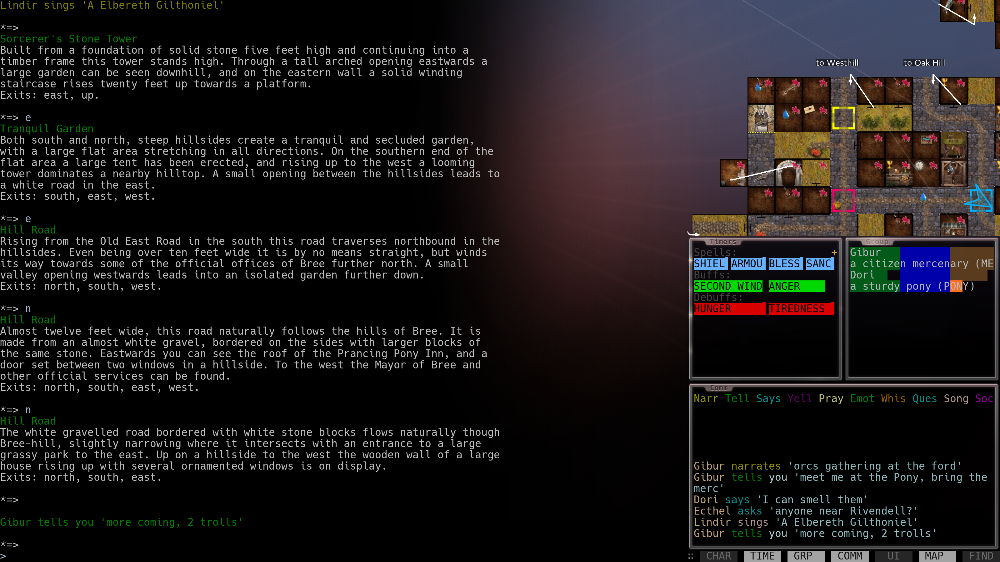
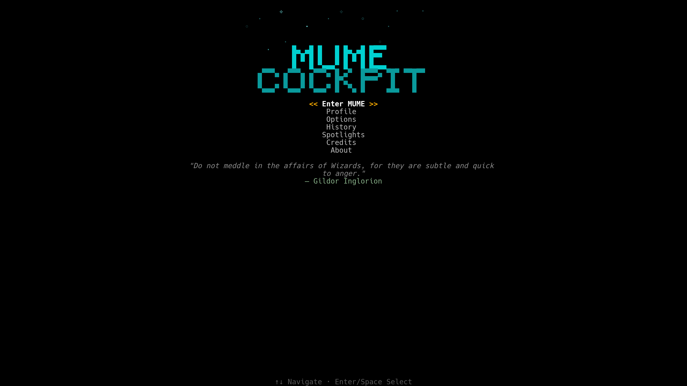
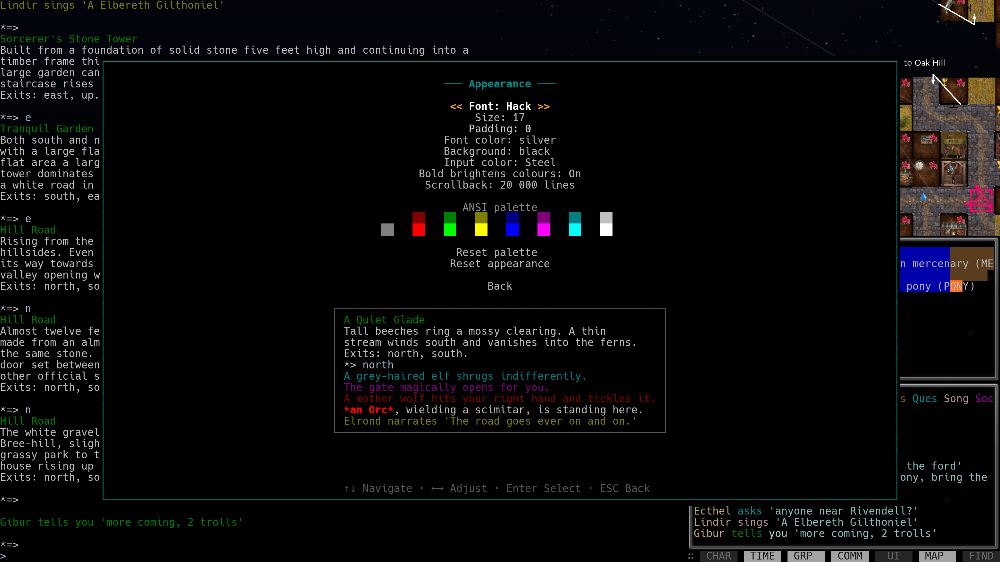
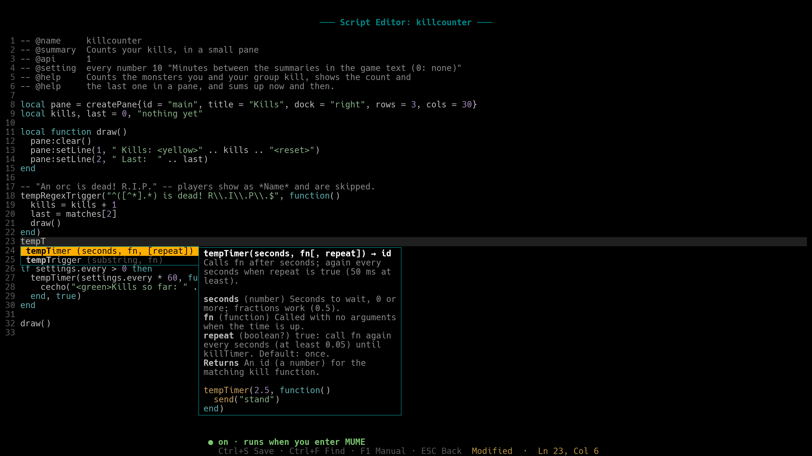
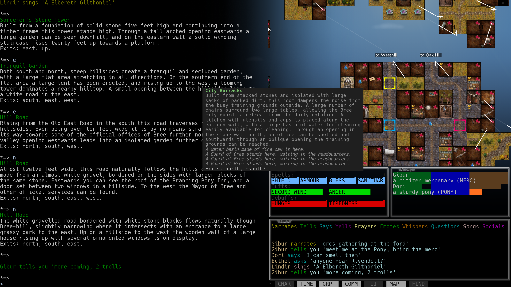
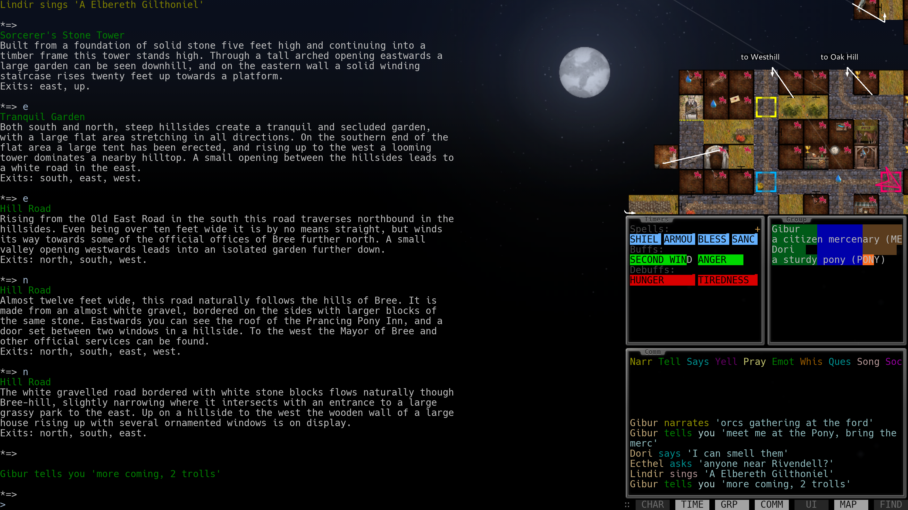
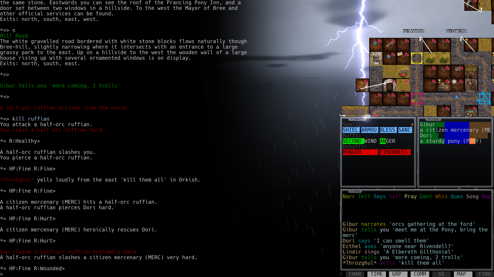
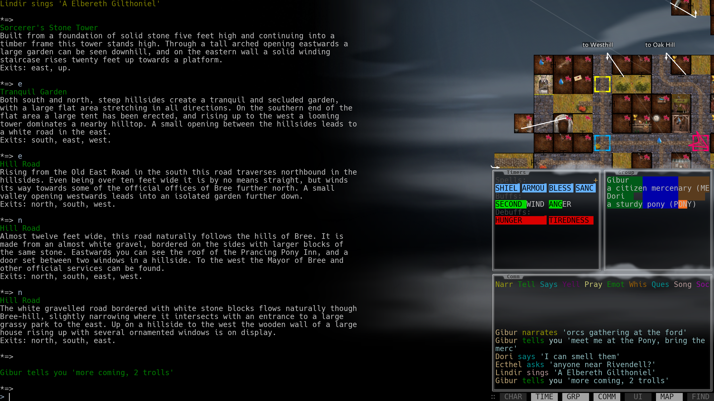
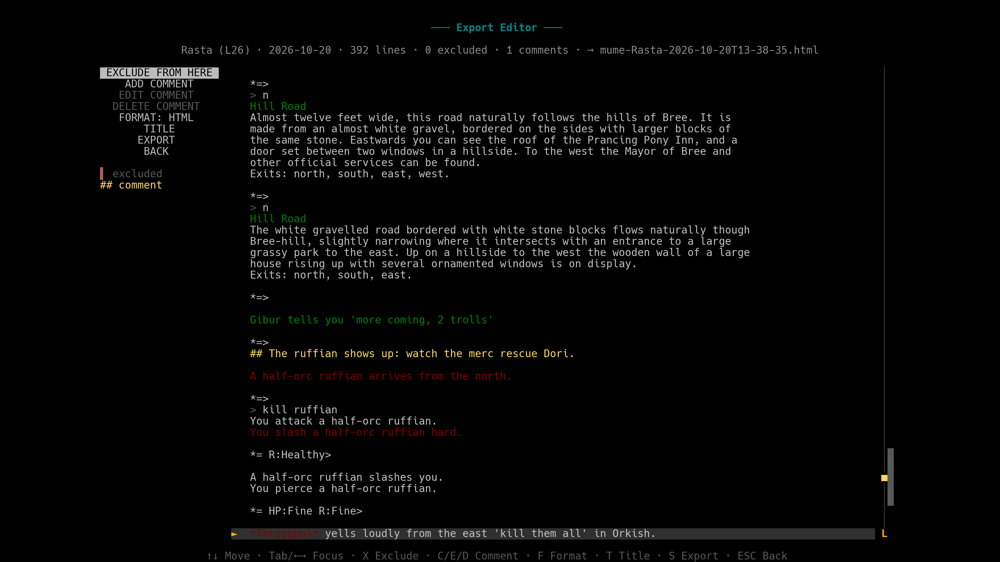
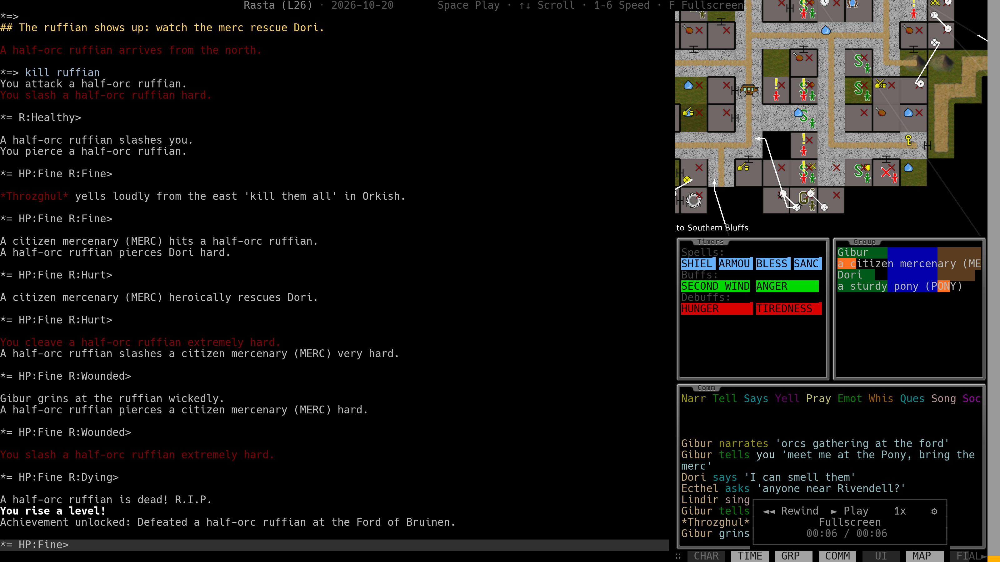

# WebCockpit

A MUD client for [MUME](https://mume.org) that runs entirely in your
browser. No installation and no server of its own: the page connects
straight to MUME, and everything you create (profiles, runs, settings,
maps) stays in your browser. It is the browser sibling of
[MUME Cockpit][cockpit], with the same panes, menus and TUI look, and
aims for tt++-level features and latency.

<p align="center">

</p>

## Run it

Open <https://mumecockpit.com/> in a desktop Chrome or
Firefox. Nothing to install. On a phone you can log in and chat; real
play needs a keyboard.

WebCockpit is a static site. To run it locally you need
[Node.js](https://nodejs.org) 24 or newer:

```
git clone https://github.com/Khazdul/webcockpit.git
cd webcockpit
npm ci
npm run dev
```

Open <http://localhost:5173> in a desktop Chrome or Firefox.

To host it yourself, run `npm run build` and serve `dist/` from any
static file server that sends `.js` as JavaScript and `.woff2` as
`font/woff2`; no special headers are needed (the public site is plain
GitHub Pages, [ADR 0029](docs/decisions/0029-custom-domain-and-tailscale-retired.md)).
To serve it under a subpath, build with `WEBCOCKPIT_BASE=/path/ npm run build`
([ADR 0028](docs/decisions/0028-github-pages-deployment.md)).

## What's in the box

**Connection.** The browser talks to `wss://mume.org/ws-play/`
directly, with full GMCP and a keep-alive that shows
your round-trip time. Nobody in between sees your password.

**Panes.** Character, Timers, Group, Communication, UI messages and
Map. They can be docked left, right, at the bottom or at the top, in
several columns or rows per side with panes spanning the whole dock, or
float over the game, and resized, reordered and toggled, each with its
own background colour.

**Appearance.** Fifteen bundled monospace fonts, font size,
padding, the ANSI palette, cursor style and blink. Changes apply
immediately, from the start page or the ESC menu.

<div align="center">


</div>

**Profiles.** Actions, aliases, highlights, macros, substitutes, gags,
variables and tickers in tt++ syntax. The profile editor has a form
view and a full text view with syntax highlighting, and both edit the
same profile. Round-trips are lossless. Macros bind any key the browser
lets through. Profiles can be exported and imported as `.tin` files,
and import also reads TinTin++, JMC, Powwow and Mudlet profiles.

**Lua scripts.** Scripts in Lua 5.4 run beside the profile, in a
sandbox, with an API for triggers, aliases, keys, timers, GMCP, the map
and panes of their own, down to bars and buttons. The script editor
completes names, shows help as you type and marks errors, and a manual
with examples is built in.

**Bundled scripts.** Ready to turn on in Options → Scripts: an almanac
of MUME's seasons, moon and events; a port key manager; map search like
MMapper's Find Rooms; a pane bar; shorter, colour-coded mob and movement
lines; a mercenary tracker; and a coin looter.

<div align="center">


</div>

**Map.** A map pane that reads MMapper `.mm2` files, draws MMapper's
tiles and follows you as you move. A default map is bundled, and you
can import your own. Options → Mapper picks the tileset: MMapper's own,
Shimrod's seasonal tiles (which follow MUME's season), Desert, Gefe &
Rik and Gray's Map. Room notes show as in MMapper, and hovering a room
tells you about it.

**Weather effects.** Sky, rain, snow, fog and lightning over the whole
client, driven by the game's GMCP: the sun rises and sets on MUME's
clock and snow builds up on the panes. Options → Weather effects turns
them off or picks what to show, and `#weather demo` plays them all. The
drawing runs in a worker, so text and keys are never slowed.

<div align="center">



</div>

**Runs.** Every login starts a run, recorded in the browser. The
start page offers History, Statistics, a log player that replays the
whole screen, and Spotlights with your kills, deaths, level-ups and
achievements. Runs older than 14 days are pruned unless you save them.

**Export editor.** Cut spans from a run, add `## ` comments to narrate
it, and export plain text or a self-contained HTML replay that anyone
can open without WebCockpit.

<div align="center">


</div>

## Documentation

- [`intent.md`](intent.md): goals, non-goals and users.
- [`spec.md`](spec.md): architecture, features and the stage plan.
- [`docs/decisions/`](docs/decisions/): ADRs for design decisions.
- [`progress.md`](progress.md): stage status and development log.

## Status

In daily use and under active development, with frequent releases.
Bug reports and feature requests are welcome on
[GitHub Issues](https://github.com/Khazdul/webcockpit/issues).

## Related

- [MUME](https://mume.org): the game. Free, no subscription.
- [MUME Cockpit][cockpit]: the terminal client this one follows.
- [MMapper](https://github.com/MUME/MMapper): the mapper whose map
  files and tiles the Map pane uses.
- The tilesets: Shimrod's for MUME MMapper (and Desert, made from it),
  [Gefe & Rik](https://github.com/octavia-mc/gefe-rik-mmapper-tileset)
  by Octavia and [Gray's Map](https://github.com/Sunnyl75/Gray-s-Map-Tileset)
  by Sunnyl75.

## License

GPL-2.0-or-later, the same licence as MMapper, so code can move both
ways. The map renderer and tracking are partly derived from MMapper
(listed in [`THIRD_PARTY_NOTICES.md`](THIRD_PARTY_NOTICES.md)). See
[`LICENSE`](LICENSE) and, for bundled fonts,
libraries and map assets,
[`THIRD_PARTY_NOTICES.md`](THIRD_PARTY_NOTICES.md).

[cockpit]: https://github.com/Khazdul/mumecockpit
